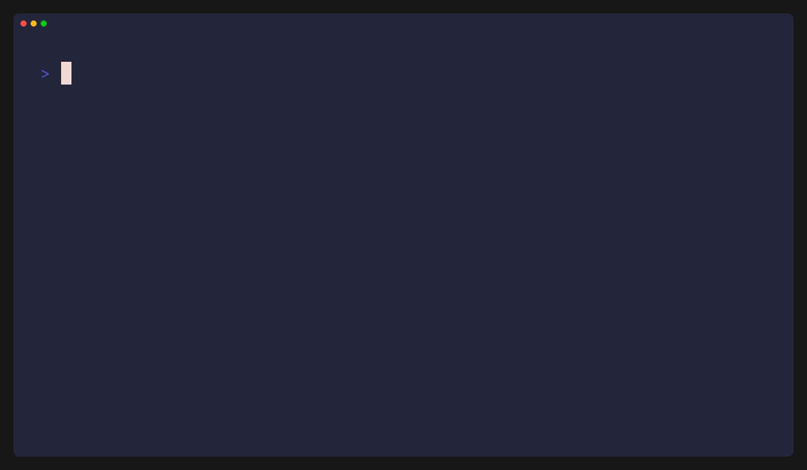

<div align="center">
  
# 🚀 JOTUN (v0.4.1)

**The lightning-fast, terminal-native personal knowledge base. Capture at the speed of thought. Organize with hierarchical power.**

<p align="center">
  <a href="LICENSE"></a>
  <a href="https://github.com/dev-Aatif/jot/releases"></a>
  <a href="https://github.com/dev-Aatif/jot/actions"></a>
  <a href="https://github.com/dev-Aatif/jot/stargazers"></a>
</p>

<p align="center">
  <a href="#🧠-usage"><strong>Explore the Docs »</strong></a>
  <br>
  <br>
  <a href="./ROADMAP.md"><strong>View Roadmap »</strong></a> ·
  <a href="https://github.com/dev-Aatif/jot/issues">Report Bug</a> ·
  <a href="https://github.com/dev-Aatif/jot/issues">Request Feature</a>
</p>

<p align="center">
  
</p>
</div>

---

## 🆕 New in v0.4.1: Reliability, Performance & Cross-Platform Releases
v0.4.1 hardens Jotun's core database, TUI, and distribution pipeline:

- **SQLite & FTS5 Integrity**: Enabled `PRAGMA foreign_keys = ON`, WAL mode, transactional tag writes, orphan tag pruning, automatic legacy `notes_fts` migration/rebuild, prefix-safe hierarchical tag filtering (`work` matches `work/*`, not `workshop`), and hardened multi-word/special-character FTS5 search.
- **Event-Driven TUI & Terminal Safety**: Added panic/error-safe terminal restoration (`TerminalGuard`), zero-idle-CPU event-driven rendering with cached `syntect` highlighting and stats, scrollable `Preview` pane (`Tab` -> `j`/`k`/`PgUp`/`PgDn`), `NO_COLOR` support, and `80×24` layout wrapping.
- **Ergonomics & Packaging**: Partial `config.toml` defaults (`#[serde(default)]`), multi-word `$EDITOR` with `.md` temp files, interactive TTY guard on `jotun new`, macOS (`pbcopy`/`pbpaste`) + Wayland/X11 (`wl-copy`/`xclip`/`xsel`) clipboard fallbacks, and cross-platform release artifacts (`linux-x86_64`, `linux-aarch64`, `darwin-x86_64`, `darwin-aarch64`) with SHA-256 verification.

---

## 📊 v0.4.0: Insights & Visual Analytics
v0.4.0 introduced the **Jotun Intelligence Suite**, giving you deep visibility into your knowledge base.

- **Insights Dashboard**: Full-screen dashboard in the TUI (press `i`) with Htop-style gauges for source distribution and a recent-notes table.
- **Penguin Stats CLI**: Neofetch-style `jotun stats` command with Penguin ASCII art and system metadata.
- **Dracula Theme Engine**: Default Dracula palette (`#bd93f9`, `#44475a`, `#f8f8f2`).

---

## 📅 v0.3.0: Hierarchical Knowledge & Performance
v0.3.0 transformed Jotun from a simple note-taker into a structured personal knowledge base.

- **Hierarchical Tagging**: Organize notes with nested paths (e.g., `work/project-a`, `personal/finance`).
- **Three-Pane Dashboard**: High-efficiency TUI with a dedicated Tags Sidebar and Note Navigator.

---

## 🚀 Performance: The Weight Class
Jotun is engineered for systems where every megabyte counts (~8 MB idle RSS in TUI mode).

| Editor | Platform | RAM Usage (Idle) |
| :--- | :--- | :--- |
| **Jotun** | **CLI/TUI** | **< 10 MB** |
| Neovim / Vim | CLI | 20 MB - 70 MB |
| Obsidian | GUI (Electron) | 400 MB - 900 MB |
| VS Code | GUI (Electron) | 600 MB - 1.5 GB |
| Logseq | GUI (Electron) | 500 MB - 1 GB |

---

## ✨ Features

- **Lightning Fast**: Built in Pure Rust with a bundled SQLite FTS5 backend (`rusqlite`).
- **Metadata Aware**: Automatically tracks `source`, `created`, and `updated` timestamps.
- **Clipboard Native**: Supports Wayland (`wl-copy`/`wl-paste`), X11 (`xclip`/`xsel`), and macOS (`pbcopy`/`pbpaste`).
- **Local First**: Your data stays on your machine. Always.
- **Minimalist**: 100% terminal focused. No bloat, no unnecessary UI.

---

## 📦 Installation

### Quick Install (Linux & macOS)
Downloads the latest release binary for your OS/architecture (`x86_64` / `aarch64`) into `~/.local/bin/jotun` and verifies its SHA-256 checksum:

```bash
curl -fsSL https://raw.githubusercontent.com/dev-Aatif/jot/main/install.sh | bash
```

### Manual From Source
Requires Rust `1.85+` (`edition = "2024"`):

```bash
git clone https://github.com/dev-Aatif/jot.git
cd jot
cargo build --release --locked
install -Dm755 target/release/jotun ~/.local/bin/jotun
```

---

## 🧠 Usage

### CLI Power-User Commands
```bash
# Create a note with metadata
jotun new "Fix login bug" --title "Auth Fix" -t work/jotun -t critical

# Pipe from stdin
echo "Meeting notes" | jotun new --title "Standup" -t work/meetings

# List notes in a specific tag hierarchy
jotun ls --tag work

# View all unique tags
jotun tags
```

### Subcommands Reference
| Command | Action |
| :--- | :--- |
| `jotun dash` | Launch the **Three-Pane Interactive Dashboard**. |
| `jotun new [text]` | Save a note with optional `--title`, `-t/--tag`, and `-s/--source` (reads piped stdin if text is omitted). |
| `jotun ls [-t tag]` | List notes with optional hierarchical tag filtering. |
| `jotun tags` | Display all unique tags. |
| `jotun show <id>` | Full note display with complete metadata. |
| `jotun find <query>` | Global FTS5 full-text search across titles and bodies. |
| `jotun edit <id>` | Edit a note in `$VISUAL`, `$EDITOR`, configured `editor`, or `nano`. |
| `jotun rm <id> [-f]` | Delete a note (prompts for confirmation unless `--force`). |
| `jotun cp <id>` | Copy a note's body to the system clipboard. |
| `jotun paste` | Create a new note from the current system clipboard content. |
| `jotun stats` | View **Neofetch-style analytics** and top tag distribution. |

### TUI Keybindings (`jotun dash`)
| Key | Action |
| :--- | :--- |
| `Tab` | Cycle active pane (`Tags` → `Notes` → `Preview`) |
| `j` / `k` or `↓` / `↑` | Navigate tags/notes or scroll `Preview` |
| `PageUp` / `PageDown` | Page scroll inside `Preview` |
| `/` or `s` | Search notes (scoped to active tag if selected; `Enter`/`Esc` exits input) |
| `n` | Create a new note in your external editor |
| `e` | Edit the selected note in your external editor |
| `y` | Copy the selected note to the clipboard |
| `d` | Delete the selected note (when `Notes` pane is active) |
| `i` | Toggle the full-screen **Insights Dashboard** |
| `q` or `Esc` | Quit |

---

## ⚙️ Configuration

Jotun creates a default configuration file at `~/.config/jotun/config.toml` on its first run. All fields are optional—partial configs merge cleanly with defaults.

```toml
editor = "nvim"                # Overrides $VISUAL / $EDITOR (supports args, e.g. "code --wait")
db_path = "/path/to/jotun.db"  # Optional custom SQLite path (or set JOTUN_DB_PATH)
syntax_highlighting = true     # Toggle Markdown highlighting in TUI (also respects NO_COLOR)

[theme]
active_border = "#bd93f9"      # Dracula Purple (hex or terminal color name)
highlight_bg = "#44475a"       # Dracula Selection
highlight_fg = "#f8f8f2"       # Dracula Foreground
```

---

## 🛣 Roadmap

Jotun has an ambitious path ahead. From visual insights to full encryption and sync.

👉 **[View the full Roadmap here](./ROADMAP.md)**

---

## 📄 License

Distributed under the **MIT License**. See `LICENSE` for more information.
